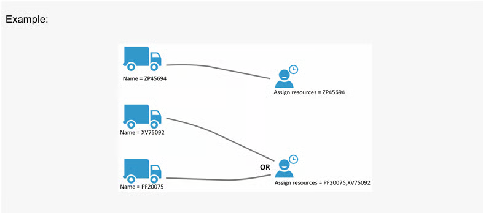

# Affecter des ressources

Cette contrainte vous permet de définir quelles ressources sont autorisées à effectuer une visite.\
La valeur saisie doit correspondre au **Nom** champ de la ressource correspondante.\
Si plusieurs ressources sont autorisées, énumérez leurs noms séparés par des virgules.

**Format :** Texte (une liste séparée par des virgules lors de la spécification de plusieurs ressources)

**Exemple :** Véhicule1, Véhicule2

<figure><figcaption></figcaption></figure>
